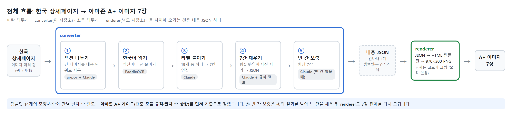
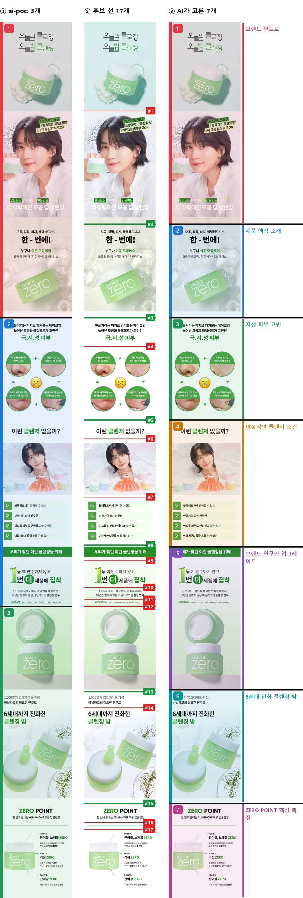
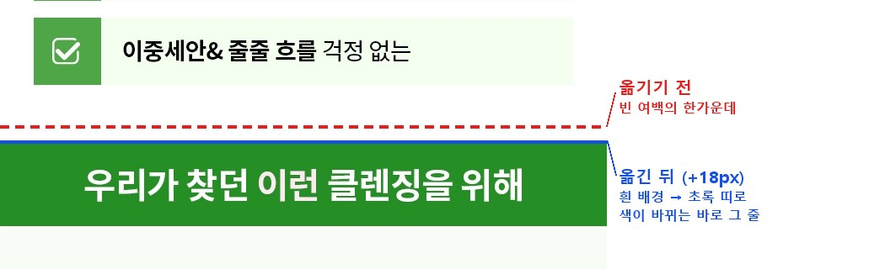
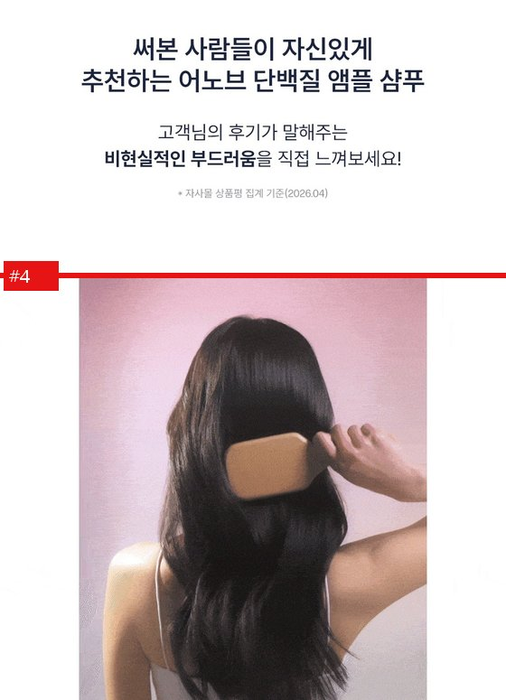
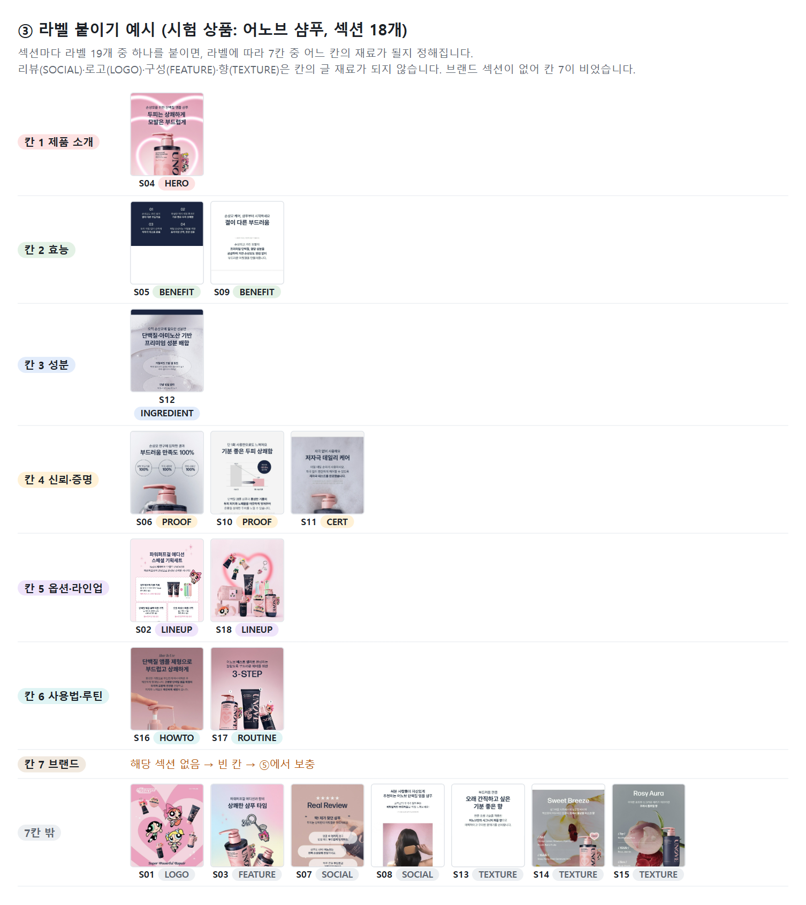
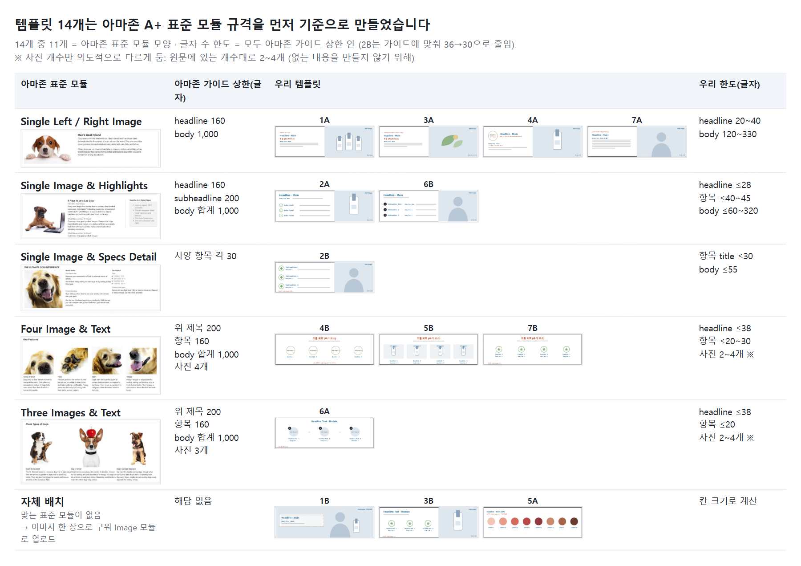
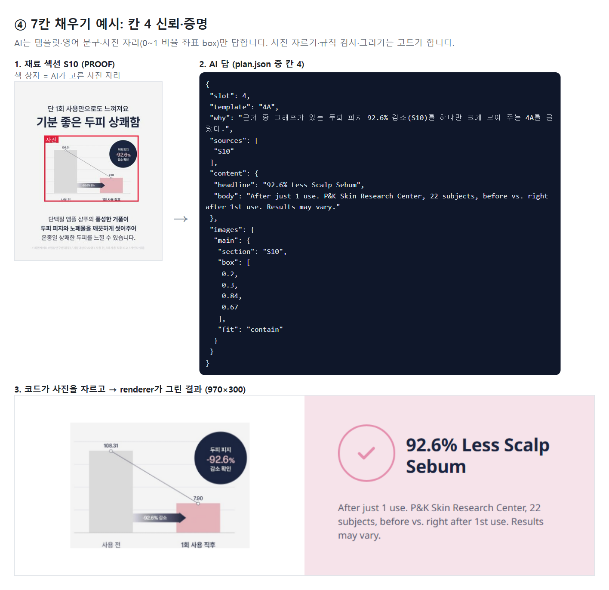
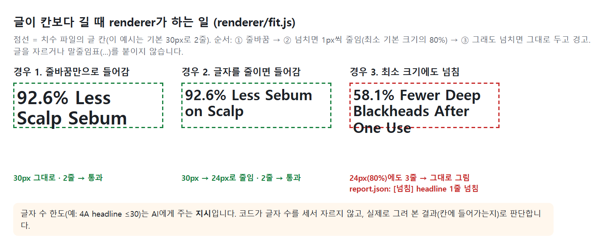
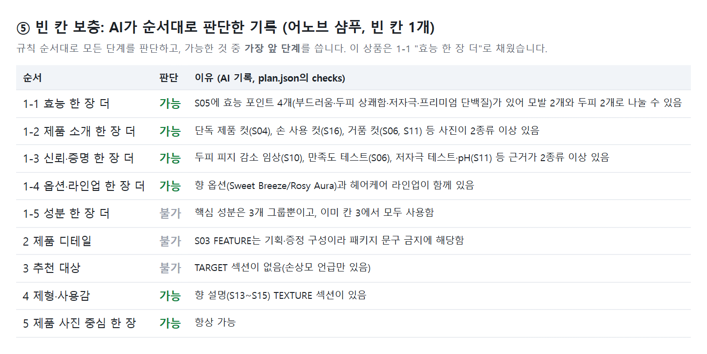
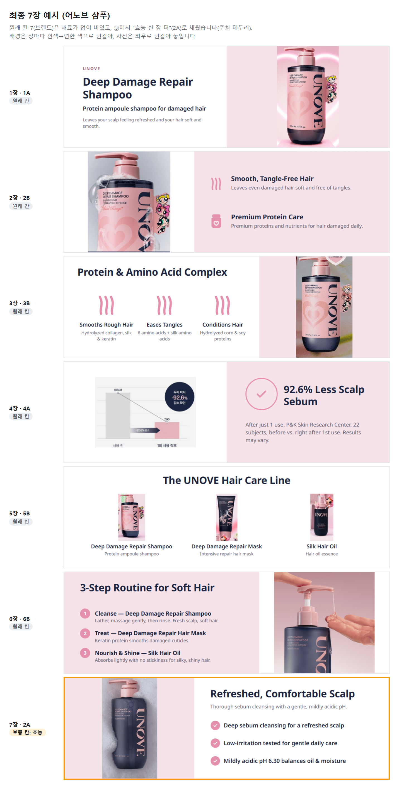

# A+ 자동 변환기 (converter)

**한국 화장품 상세페이지 이미지**를 넣으면 **아마존 US A+ 콘텐츠 이미지(970×300) 7장**을 만드는 시제품 코드입니다.

> **이 코드를 어떻게 쓰면 되나요**
> - 서비스에 그대로 넣는 코드가 아닙니다. **참고용 시제품**입니다. 모델 담당자가 읽고 서비스 구조에 맞게 옮겨 구현하는 것을 전제로 썼습니다.
> - 이미지를 실제로 그리는 부분은 같은 저장소의 **`aplus-renderer` 브랜치**(`aplus_renderer/` 폴더)에 있습니다. 이 문서는 둘을 합친 **전체 흐름**까지 설명합니다.
> - 시제품의 목표는 **"한국 섹션 → 아마존 모듈 규격으로 바꾸기"** 하나입니다. 규제 검사, 번역 다듬기, 누끼는 범위 밖입니다([10장](#10-범위-밖--아직-없는-것)).

> ### ✅ 아마존 A+ 가이드를 먼저 기준으로 삼았습니다
> 템플릿 모양, 치수, 칸별 글자 수 한도는 모두 **아마존 A+ 가이드(표준 모듈 규격과 글자 수 상한)를 먼저 반영해서** 정했습니다.
> - **템플릿:** 14개 중 11개가 아마존 표준 모듈과 같은 모양입니다(Single Left/Right Image, Highlights, Specs Detail, Four Image & Text, Three Images & Text). 맞는 표준 모듈이 없는 3개(1B·3B·5A)는 이미지 한 장으로 만들어 Image 모듈로 올립니다.
> - **글자 수:** 모든 칸의 한도가 가이드 상한 안에 있습니다. 가이드와 어긋났던 2B 항목 제목은 가이드에 맞춰 36자에서 30자로 줄였습니다.
> - **의도적으로 다르게 둔 것은 하나뿐입니다.** 반복 칸의 사진 개수를 가이드처럼 3개·4개로 고정하지 않고, 원문에 있는 개수대로 2~4개로 둡니다. 없는 내용을 만들지 않기 위해서입니다.
> - 자세한 비교는 [4장](#4-아마존-가이드-반영-템플릿과-글자-수-한도)에 있습니다.

---

## 목차
0. [3분 요약](#0-3분-요약)
1. [전체 흐름](#1-전체-흐름)
2. [① 섹션 나누기 · ② 한국어 읽기](#2--섹션-나누기---한국어-읽기)
3. [③ 라벨 붙이기](#3--라벨-붙이기)
4. [아마존 가이드 반영: 템플릿과 글자 수 한도](#4-아마존-가이드-반영-템플릿과-글자-수-한도)
5. [④ 7칸 채우기](#5--7칸-채우기)
6. [그리기 (renderer 연결)](#6-그리기-renderer-연결)
7. [⑤ 빈 칸 보충 → 최종 7장](#7--빈-칸-보충--최종-7장)
8. [성능](#8-성능)
9. [서비스로 옮길 때 정해야 할 것](#9-서비스로-옮길-때-정해야-할-것)
10. [범위 밖 · 아직 없는 것](#10-범위-밖--아직-없는-것)
11. [파일 목록](#11-파일-목록)
12. [실행 방법 (참고)](#12-실행-방법-참고)
13. [용어 풀이](#13-용어-풀이)

---

## 0. 3분 요약

| 질문 | 답 |
|---|---|
| 무엇을 넣나 | 한국 상세페이지 이미지 파일들. 위→아래 순서이고, 여러 장으로 잘려 있어도 됩니다 |
| 무엇이 나오나 | 아마존 A+ 이미지 7장(970×300 PNG)과, 각 장을 그린 **내용 JSON** 7개 |
| 어떤 순서로 | ① 섹션 나누기 → ② 한국어 읽기 → ③ 라벨 붙이기 → ④ 7칸 채우기 → 그리기 → ⑤ 빈 칸 보충 → 최종 7장 |
| 아마존 규격 | 템플릿과 글자 수 한도는 **아마존 A+ 가이드를 먼저 기준으로** 정함 (4장) |
| AI는 어디에 쓰나 | 경계 고르기, 라벨, 7칸 채우기, 빈 칸 보충 (Claude). **글자는 AI가 아니라 renderer 코드가 그립니다** → 오타가 없습니다 |
| 상품 1개 비용·시간 | 약 $0.7~1.5, 15~25분 (CPU 기준) |
| 성능 (시험 상품 8개) | 섹션 91%/94%, 라벨 99%, 7칸 템플릿 96% |
| 가장 먼저 읽을 코드 | `step4_fill.py`의 `SELECT`(템플릿 고르기 기준)와 `SPECS`(글자 수 한도) |
| 담당자가 받는 형식 | `step4/final/content/slot<N>_<템플릿>.json` (renderer 입력 형식) |

---

## 1. 전체 흐름



이 시제품은 두 브랜치로 나뉩니다. **서비스에서 돌아가는 것은 두 개 모두**입니다.

| 브랜치 (폴더) | 하는 일 | 받는 것 → 내는 것 |
|---|---|---|
| **aplus-converter** (`aplus_auto/`, 여기) | 한국 상세페이지를 나누고, 읽고, 분류해서 **7칸에 들어갈 내용을 정함** | 상세페이지 이미지 → 내용 JSON 7개 |
| **aplus-renderer** (`aplus_renderer/`) | 내용 JSON을 받아 **이미지를 그림** | 내용 JSON → 970×300 PNG + 경고 보고서 |

- 두 부분 사이에 오가는 것은 **내용 JSON 하나뿐**입니다. 형식은 renderer README의 "입력 JSON 형식"에 있습니다.
- converter가 renderer를 직접 불러서 그림까지 만듭니다(`step4_fill.py`, `step4b_fill_empty.py`).
- 참고: 템플릿 14개의 모양과 치수는 이 작업 전에 **아마존 A+ 이미지 2,054장을 분석해서** 정했습니다. 그 분석 코드는 서비스와 관계없어 올리지 않았습니다. 결과(치수 파일)는 renderer의 `spec/templates_spec.json`에 들어 있습니다.

**단계마다 결과 파일을 남깁니다.** 각 단계는 앞 단계 결과 파일을 읽고 자기 결과를 `work/<상품>/` 아래에 씁니다. AI 응답은 모두 저장(캐시)해서, 같은 입력으로 다시 돌리면 비용이 들지 않습니다.

| 단계 | 코드 | AI | 결과 파일 |
|---|---|---|---|
| ① 섹션 나누기 | `step1_sections.py` 외 4개 | Claude | `step1_final_src/sections_all.json` |
| ② 한국어 읽기 | `step2_text.py`, `ocr_kr.py` | 없음 | `step2/section_texts.json` |
| ③ 라벨 붙이기 | `step3_label.py`, `step3b_apply_review.py` | Claude 1회 | `step3/labels_final.json` |
| ④ 7칸 채우기 + 그리기 | `step4_fill.py` (+ 디자인 규칙 3개) | Claude 1회 (+1B 확인) | `step4/plan.json`, `content/`, `renders/` |
| ⑤ 빈 칸 보충 → 최종 7장 | `step4b_fill_empty.py` | Claude (빈 칸 있을 때) | `step4/final/` |
| 전체 자동 실행 | `pipeline.py` | — | `progress.json` |

---

## 2. ① 섹션 나누기 · ② 한국어 읽기

### ① 섹션 나누기

**목적:** 긴 상세페이지를 "한 가지 내용" 단위(제품 소개, 효능, 성분 …)로 자릅니다.



| 순서 | 코드 | 하는 일 | AI |
|---|---|---|---|
| ①-1 | ai-poc `run_color.py` | 배경색이 바뀌는 곳과 빈 여백으로 1차로 자름 | 없음 |
| ①-2 | `step1b_claude_split.py` | 자를 수 있는 **후보 줄마다 번호**를 그린 그림을 AI에 보여 주고 **번호만** 고르게 함 | Claude |
| ①-3 | `step1c_apply_review.py` + `cut_snap.py` | 120px 미만 조각(빈 띠)을 빼고, 자른 선을 빈 여백 안에서 **배경색이 바뀌는 줄**로 옮김 | 없음 |
| ①-4 | `step1d_merge_boundaries.py` | 이미지 파일 경계에서 앞 파일 끝 조각과 다음 파일 첫 조각이 **같은 내용이면 합침** | Claude |
| ①-5 | `step1_sections.py` | 확정 섹션 목록(S01, S02…)과 확인 화면을 만듦 | 없음 |

**왜 이렇게 했나**
- **좌표가 아니라 번호를 고르게 한 이유:** AI에게 "몇 px에서 자를지" 물으면 글자 중간을 자르는 일이 생깁니다. 빈 여백에만 후보를 그려 두고 번호만 고르게 하면 그런 일이 없습니다. ai-poc의 `color_snap_vlm2`와 같은 아이디어입니다.
- **그림 전체를 보여 준 이유:** ai-poc 공식 방식은 "3000px 넘게 색 변화가 없는 긴 구간"만 AI에 보냅니다. 그런데 한국 상세페이지는 배경이 사진이나 그라데이션인 경우가 많아서, 무료 단계만으로는 섹션이 너무 적게 나왔습니다. 위 예시에서는 7개여야 할 섹션이 3개만 나왔습니다.
- **선을 옮기는 이유(cut_snap):** 한국 상세페이지는 섹션마다 배경색이 바뀝니다. 선을 옮기자 정밀도가 68→71%, 재현율이 78→81%로 올랐습니다. "가장 크게 색이 바뀌는 곳"으로 옮기는 방법도 시험했는데, 사진 테두리로 끌려가 53%/61%로 오히려 나빠져서 쓰지 않았습니다.





> ⚠️ **ai-poc 코드는 고치지 않고 그대로 실행만 합니다.** 이미지를 ai-poc가 읽는 폴더(`data/golden_sample/images_<상품>`)에 복사해 둘 뿐입니다.
> ⚠️ ①-2는 **임시 방식**입니다. 팀 Gemini 키가 없어서 Claude로 했습니다. 서비스는 ai-poc Gemini 방식을 쓰기로 되어 있습니다([9장](#9-서비스로-옮길-때-정해야-할-것)).

### ② 한국어 읽기

**목적:** 섹션마다 그 안의 한국어 글을 붙입니다. ③에서 라벨을 정할 때와 ④에서 영어로 옮길 때 씁니다.

| 코드 | 하는 일 |
|---|---|
| `ocr_kr.py` | PaddleOCR로 한국어 줄을 읽고 문단으로 묶음 |
| `step2_text.py` | 문단의 가운데 높이가 어느 섹션 범위 안에 있는지 보고 섹션에 배정 → `section_texts.json` |

- 설정은 **팀 확정값**입니다. 글자 위치는 `PP-OCRv5_server_det`, 글자 읽기는 `korean_PP-OCRv5_mobile_rec`, 신뢰도 0.60 미만은 버립니다.
- 4,000px가 넘는 섹션은 2,000px씩 300px 겹치게 나눠 읽습니다. 긴 이미지를 통째로 넣으면 검출기가 이미지를 줄여서 작은 글자가 사라지기 때문입니다.

---

## 3. ③ 라벨 붙이기

**목적:** 섹션마다 "무슨 내용인지" 라벨을 붙이고, 그 라벨로 **7칸 중 어느 칸의 재료가 될지** 정합니다.



### 어떻게 하나

| 순서 | 하는 일 | 코드 |
|---|---|---|
| 1 | 모든 섹션을 **한 번에** 보냄. 섹션마다 이미지(긴 변 1,568px로 줄임) + ②에서 읽은 한국어 글 | `step3_label.py` |
| 2 | AI가 섹션마다 라벨 1개, 보조 라벨, 확신도, 이유, 요약(한국어)을 JSON으로 답함 | 〃 |
| 3 | 코드가 라벨을 7칸 번호로 바꿈 (아래 표, `SLOTS`) | 〃 |
| 4 | (선택) 사람이 확인 화면에서 고친 라벨(CSV)을 반영 → `labels_final.json` | `step3b_apply_review.py` |

- AI 호출은 상품당 **1번**입니다. 섹션을 하나씩 따로 묻지 않고 한꺼번에 보내야, 앞뒤 섹션을 보고 더 정확하게 판단합니다.
- **라벨 기준은 아마존 A+ 2,054장을 분류할 때 쓴 분류 가이드(v1.4)와 같습니다.** 그 가이드 본문을 그대로 AI 지시문에 넣고, 대상만 "한국 상세페이지 섹션"으로 바꿨습니다. 그래서 한국 섹션의 라벨과 아마존 A+의 라벨을 같은 말로 비교할 수 있습니다.
  - 가이드 파일: `docs/A+내용종류_분류가이드_v1.4.md` (함께 올립니다). ⚠️ 지금 코드는 이 파일을 내 PC의 `Claude outputs/A+내용종류_분류가이드_v1.4_2026-11-08.md` 경로에서 읽습니다. 옮길 때 `step3_label.py`의 `GUIDE` 경로를 바꿔 주세요.

### 라벨 19개와 7칸

| 라벨 | 뜻 | 7칸 |
|---|---|---|
| HERO | 제품 소개 | 1 제품 소개 |
| BENEFIT | 핵심 효능·특징 | 2 효능 |
| INGREDIENT | 성분·기술 | 3 성분 |
| PROOF · CERT · COMPARE | 효과 증명 · 인증·검증 · 비교 | 4 신뢰·증명 |
| VARIANT · LINEUP | 색상·옵션 · 라인업 | 5 옵션·라인업 |
| HOWTO · ROUTINE | 사용법 · 루틴 | 6 사용법·루틴 |
| BRAND | 브랜드 이야기 | 7 브랜드 |
| SOCIAL | 신뢰·평판 (리뷰·판매량·#1·수상) | **7칸 밖, 쓰지 않음** |
| TEXTURE · FEATURE · TARGET · PROBLEM | 제형·사용감 · 제품 디테일 · 추천 대상 · 고민 제시 | 7칸 밖 (⑤ 보충 재료로만) |
| LOGO · FAQ · OTHER | 로고 띠 · 질문·안내 · 기타 | 7칸 밖 |

- **SOCIAL을 칸에 넣지 않는 이유:** 아마존 A+ 가이드가 리뷰 인용을 금지합니다. 그래서 4 신뢰·증명 칸에는 PROOF·CERT·COMPARE만 넣고, 리뷰·평판 내용은 글도 사진도 쓰지 않습니다.
- 위 예시처럼 브랜드 섹션이 없으면 칸 7은 비어 있게 됩니다. 이런 빈 칸은 ⑤에서 채웁니다.

---

## 4. 아마존 가이드 반영: 템플릿과 글자 수 한도

> 이 장의 기준 자료: 대행사 정리본 *Amazon A+ Content Creation Guidelines (Awesome Dynamic)* 과 아마존 표준 모듈 안내 PDF. 최종 기준인 **셀러센트럴 화면은 아직 확인하지 않았습니다.**



### 4-1. 7칸 × 템플릿 2개 = 14개

칸마다 A·B 두 템플릿이 있습니다. AI가 원문 내용을 보고 둘 중 하나를 고릅니다([5장](#5--7칸-채우기)).

| 칸 | A (아마존 표준 모듈) | B (아마존 표준 모듈) |
|---|---|---|
| 1 제품 소개 | 1A — Single Left/Right Image | 1B — 자체 배치 (사진이 칸 전체) |
| 2 효능 | 2A — Single Image & Highlights | 2B — Single Image & Specs Detail |
| 3 성분 | 3A — Single Left/Right Image | 3B — 자체 배치 |
| 4 신뢰·증명 | 4A — Single Left/Right Image | 4B — Four Image & Text |
| 5 옵션·라인업 | 5A — 자체 배치 (색상 스와치) | 5B — Four Image & Text |
| 6 사용법·루틴 | 6A — Three Images & Text | 6B — Single Image & Highlights |
| 7 브랜드 | 7A — Single Left/Right Image | 7B — Four Image & Text |

- 결과는 칸마다 **970×300 이미지 한 장으로 만들어서** 넘깁니다. 셀러는 아마존의 Image 모듈에 이 이미지를 올리면 됩니다. 표준 모듈의 칸을 셀러가 다시 채울 필요가 없습니다.

### 4-2. 칸별 글자 수 한도

한도는 영어 기준, 공백 포함입니다. **두 기준을 모두 지키도록** 정했습니다.
1. **아마존 가이드 상한을 넘지 않을 것**
2. 970×300 칸 상자에 실제로 들어갈 것

그래서 둘 중 더 작은 값을 씁니다. 코드에서는 `step4_fill.py`의 `SPECS` 문자열에 있습니다.

| 템플릿 | 우리 한도 | 해당 아마존 모듈의 가이드 상한 |
|---|---|---|
| 1A | label ≤20 · headline ≤40 (2줄) · subheadline ≤36 · body ≤120 | headline 160 · body 1,000 |
| 1B | headline ≤22 · body ≤85 | (자체 배치) |
| 2A | headline ≤28 · body ≤60 · 항목 ≤45 (3개) / ≤40 (4개) | headline 160 · subheadline 200 · body 합계 1,000 |
| 2A 대표 하나형 | headline ≤40 · body ≤160 | 〃 |
| 2B | 항목 title **≤30** · body ≤55 | 사양 항목 각 30 |
| 3A | headline ≤20 · subheadline ≤36 · body ≤120 | headline 160 · body 1,000 |
| 3B | headline ≤30 · 항목 title ≤18 / ≤13 · body ≤45 / ≤32 | (자체 배치) |
| 4A | headline ≤30 · body ≤120 | headline 160 · body 1,000 |
| 4B | headline ≤38 · 항목 title ≤30 (전후 모드: 라벨 ≤12) | 위 제목 200 · 항목 160 · body 합계 1,000 |
| 5B | headline ≤38 · 항목 title ≤26 · body ≤40 | 〃 |
| 6A | headline ≤38 · 항목 title ≤20 · body ≤40 | 〃 |
| 6B | headline ≤28 · 항목 title ≤40 · body ≤60 (3단계) / ≤150 (2단계) · 줄글형 body ≤320 | headline 160 · subheadline 200 · body 합계 1,000 |
| 7A | headline ≤20 · body ≤330 | headline 160 · body 1,000 |
| 7B | headline ≤38 · 항목 title ≤20 · body ≤40 | 위 제목 200 · 항목 160 · body 합계 1,000 |

- **모든 칸이 가이드 상한 안에 있습니다.** 대부분은 970×300 한 장에 들어가는 글자 수가 가이드 상한보다 훨씬 작아서, 칸 크기 쪽이 실제 한도가 됩니다.
- **2B는 가이드에 맞춰 바꿨습니다.** 처음에는 칸 크기로 36자였는데, Specs Detail 모듈의 사양 항목 상한(30자)을 넘어서 30자로 줄였습니다.
- 2A 항목은 가이드에 따로 상한이 없어서, 가장 비슷한 subheadline(200자)으로 보고 비교했습니다(추정).

### 4-3. 사진 개수: 의도적으로 다르게 둔 것

| | 아마존 가이드 | 우리 템플릿 |
|---|---|---|
| Three Images & Text (6A) | 사진 3개 고정 | 2~4개, 원문 개수대로 |
| Four Image & Text (4B·5B·7B) | 사진 4개 | 2~4개, 원문 개수대로 |

**이유:** 원문 단계가 2개뿐인데 칸을 3개·4개로 억지로 채우면, 없는 내용을 만들게 됩니다. 결과는 이미지 한 장으로 넘기므로 셀러 업로드에는 지장이 없습니다.

### 4-4. 한도는 "지시"이고, 코드가 막지는 않습니다

- 한도는 **AI에게 주는 지시문 안에만** 있습니다. 글자 수를 세서 자르거나 거절하는 코드는 없습니다.
- 대신 renderer가 실제로 그려 보고 칸에 들어가는지 확인합니다([6장](#6-그리기-renderer-연결)).
- **자르지 않는 이유:**
  - 기계적으로 자르면 "58.1% Fewer Deep Blackheads Af"처럼 뜻이 깨집니다.
  - "Results may vary." 같은 꼭 필요한 문장이 빠질 수 있습니다.
  - 진짜 기준은 글자 수가 아니라 "칸에 들어가느냐"입니다. 같은 30자라도 W와 i는 폭이 다릅니다.
- **실제 측정 (시험 상품 16개, 글 칸 526개):**
  - 아마존 가이드 상한을 넘은 칸은 2개였습니다. 둘 다 2B 한도가 36자이던 때 만든 결과입니다.
  - 우리 한도를 넘은 칸은 9개(1~14자 초과)였습니다. 7개는 글자를 줄여서 칸에 들어갔고, 2개는 넘침 경고가 났습니다.

---

## 5. ④ 7칸 채우기

**목적:** 칸마다 ① 템플릿을 고르고 ② 영어 문구를 쓰고 ③ 원본에서 쓸 사진 자리를 정한 뒤, renderer 입력 JSON을 만듭니다.



### 5-1. 처리 순서 (`step4_fill.py`)

| 순서 | 하는 일 | 누가 |
|---|---|---|
| 1 | 섹션마다 이미지 + 가장자리 **눈금(0~100%)** + 한국어 글 + 라벨·칸 번호 + 상품명을 모아 보냄 | 코드 |
| 2 | 칸 1~7마다 템플릿·고른 이유·영어 문구·한국어 뜻·사진 자리(box)를 답하고, 마지막에 색 테마 4가지를 답함 | **Claude (1회)** |
| 3 | **규칙 검사**: AI 답을 코드 규칙으로 바로잡음 (5-3) | 코드 |
| 4 | 상품명에서 기획·증정·용량 표기를 떼고, 본문의 `Tip:`·`Note:` 앞에서 줄을 바꿈 | 코드 |
| 5 | 필수 사진이 빈 칸에는 다른 칸의 제품 사진을 넣고 "확인 필요" 표시를 남김 | 코드 |
| 6 | box 좌표대로 원본 섹션에서 사진을 잘라 `images/`에 저장 | 코드 |
| 7 | 배경색 번갈아(`bg_rules.py`), 아이콘 고르기(`icon_pick.py`) | 코드 |
| 8 | **1B만:** 자른 사진에서 제품이 어디 있는지 AI에게 물어, 글 상자를 제품 반대쪽에 둠 (칸당 약 1센트) | Claude (작은 호출) |
| 9 | 좌우 번갈아(`zigzag.py`), 바뀐 칸은 배경 다시 계산 | 코드 |
| 10 | 칸마다 내용 JSON을 `content/`에 쓰고 → renderer로 그림 → `plan.json`에 모두 기록 | 코드 + renderer |

### 5-2. 템플릿을 고르는 기준 (`SELECT`)

AI 지시문에 들어 있는 표입니다. A를 기본값으로 두지 않고, 원문 내용으로 A와 B 중에 고릅니다.

| 칸 | A를 고를 때 | B를 고를 때 |
|---|---|---|
| 1 제품 소개 | 제품·제품 묶음 사진이 중심 → **1A** | 모델·손과 제품이 한 사진에 함께 있음 → **1B** |
| 2 효능 | 짧은 체크 문구형 효능 → **2A** | 효능마다 이름 + 설명 → **2B** |
| 3 성분 | 핵심 성분 1~2개 강조 + 원료 사진 → **3A** | 성분 3개 이상을 각각 설명 → **3B** |
| 4 신뢰·증명 | 가장 중요한 근거 하나를 크게 → **4A** (기본) | 근거마다 인증 마크·배지 그림이 있음, 또는 같은 근거의 전/후 사진 2장 → **4B** |
| 5 옵션·라인업 | 색상·향 옵션(스와치) → **5A** | 같은 브랜드의 다른 제품 → **5B** |
| 6 사용법·루틴 | 단계마다 사진이 있음 → **6A** | 단계가 글로만 있음 → **6B** (번호 없는 줄글이면 6B 줄글형) |
| 7 브랜드 | 긴 브랜드 이야기 → **7A** | 브랜드 가치 키워드 3~5개 → **7B** |

이 기준은 시험 상품 8개, 52칸을 사람이 검수(2026-11-11~12)하면서 다듬었습니다. 지시문에 적힌 주요 결정은 이렇습니다.

| 칸 | 사람 검수에서 정한 것 |
|---|---|
| 공통 | 반복 칸 개수는 **원문 개수대로**(2~4개). 바로 앞 칸과 같은 뼈대는 피함 |
| 2 효능 | 효능이 포인트로 정리돼 있지 않으면 번호를 억지로 만들지 않고 **2A 대표 하나형**(가장 중요한 효능 하나를 제목 + 짧은 문단) |
| 1 제품 소개 | 1B 큰 글씨는 **제품명**. 제품이 사진에서 잘리면 안 됨. 모델 얼굴만 있고 제품이 없으면 1A |
| 4 신뢰·증명 | 근거를 작게 여러 개 늘어놓지 않음(970×300에서 안 보임). 그래프·전후 사진은 **일부를 확대하지 않고 통째로** |
| 5 옵션 | 옵션은 전부(최대 12개). 발색 사진이 있으면 패키지 사진보다 먼저 |
| 5B 라인업 | 콜라보·한정·기획세트 이름은 빼고 그냥 브랜드 라인업. 항목 사진은 **그 제품 단독 사진**만 |
| 3 성분 | 성분 3개 이상을 각각 설명하면 하나로 묶지 않고 3B로 하나씩 |
| 7 브랜드 | 7A 사진은 그 브랜드 제품 사진을 먼저 |
| 아이콘 | 항목에 사진이 없을 때만, **뜻이 맞는 아이콘이 있을 때만** |

### 5-3. AI 답을 코드가 바로잡는 규칙 (`apply_rules`)

AI가 지시를 어길 때를 대비해, 코드가 한 번 더 검사합니다. 고친 내용은 칸의 `flags`에 남깁니다.

| 규칙 | 내용 |
|---|---|
| 엄격 재료 규칙 | 칸의 **글 재료**는 그 칸 라벨의 섹션만 씀. 다른 라벨 섹션이 들어오면 뺌 |
| 한 섹션 한 칸 | 앞 칸에서 쓴 섹션은 뒤 칸에서 뺌 |
| 재료 없으면 빈 칸 | 재료가 하나도 안 남은 칸은 비움 (1 제품 소개는 예외: 제품 사진 + 제품명으로 만듦) |
| 사진은 예외 | 큰 사진은 다른 섹션의 제품·모델 사진을 가져와도 됨. 단 리뷰·안내·로고 섹션 사진이면 "확인 필요" |
| 근거 그림 | 4A·4B 사진은 항상 통째로(`contain`) |
| 5B 사진 | 라인업 사진이 사용법·제형 등 섹션에서 왔으면 "제품 단독 사진인지 확인" |

### 5-4. 문구 규칙 (지시문)

- 미국 아마존 화장품 페이지에 맞는 자연스러운 영어로 씁니다. 직역하지 않고 뜻을 살려 짧게 씁니다.
- **한국 페이지에 있는 사실만** 씁니다. 수치, 시험 조건, 성분명은 그대로 옮기고 지어내지 않습니다.
- 근거 수치를 쓰면 조건(대상·기간·기관)을 짧게 붙입니다. 예시 그림의 body가 그렇습니다.
- 의약품처럼 보이는 표현(treat, cure, heal 등), 리뷰·별점·"#1" 같은 순위 표현, 기획·증정·용량 구성 문구는 쓰지 않습니다.

### 5-5. 결과 파일

| 파일 | 내용 |
|---|---|
| `step4/plan.json` | 칸별 템플릿, 고른 이유, 영어, 한국어 뜻, 사진 자리, 규칙 표시(flags), 그리기 경고, 비용 |
| `step4/content/slot<N>_<템플릿>.json` | **renderer 입력 JSON** (담당자에게 넘기는 형식) |
| `step4/images/` | 원본에서 잘라 낸 사진 |
| `step4/sources/` | 원본 섹션 위에 사진 자리를 표시한 그림 (검수용) |
| `step4/renders/` | 그린 결과 PNG |

---

## 6. 그리기 (renderer 연결)

converter는 그리기를 직접 하지 않고 **renderer의 `batch.run`을 부릅니다.** renderer 안에서는 이렇게 처리합니다.

| 순서 | renderer 안에서 하는 일 | 파일 |
|---|---|---|
| 1 | 입력 JSON 검사: 템플릿마다 필수 칸이 있는지, 항목 개수가 맞는지 | `renderer/spec.py` |
| 2 | 치수 파일의 상자를 실제 좌표로 계산. 반복 칸은 개수대로 나누고, 좌우 반전이면 x를 뒤집음 | `renderer/layout.py` |
| 3 | 템플릿 HTML에 내용을 채움 | `templates/*.html` |
| 4 | 브라우저(Playwright)에서 글자를 칸에 맞춤 (아래 그림) | `renderer/fit.js` |
| 5 | 970×300으로 찍어 PNG 저장 + 경고 보고서 | `renderer/core.py` |



**경고 종류** (각 칸의 `render.warnings`)
- `[넘침]`: 최소 크기로 줄여도 글이 칸을 넘음
- `[위치]`: 요소가 치수 구역 밖으로 나감
- `[이미지]`: 사진을 불러오지 못함
- `[크기]`: 결과가 970×300이 아님

자세한 내용은 renderer README에 있습니다.

---

## 7. ⑤ 빈 칸 보충 → 최종 7장

**목적:** ④에서 재료가 없어 비는 칸이 있으면, 정해진 순서로 채워서 **항상 7장**을 만듭니다. ④의 결과는 고치지 않고, 결과를 `step4/final/`에 따로 씁니다.

### 7-1. 원칙
- **없는 내용은 만들지 않습니다.** 한국 페이지에 실제로 있는 정보로만 채웁니다.
- 안내·FAQ·로고·리뷰(SOCIAL)는 보충 재료로 쓰지 않습니다.
- 한 상품에서 같은 보충 유형을 두 번 쓰지 않습니다.
- 다른 칸에 이미 나온 문구·사진을 그대로 되풀이하지 않습니다. 같은 섹션의 **다른** 내용은 씁니다.
- ④의 사람 검수 기준(5-2)을 보충 칸에도 똑같이 지킵니다. 엄격 재료 규칙만 예외입니다. 그래서 7칸 밖 라벨(FEATURE·TARGET·TEXTURE)도 보충 재료가 될 수 있습니다.

### 7-2. 채우는 순서

위에서부터 가능한 것을 씁니다. 원문 규칙은 `TODO_빈칸보충규칙.md`에 있습니다.

| 순서 | 보충 유형 | 조건 | 템플릿 예 |
|---|---|---|---|
| 1-1 | 효능 한 장 더 | 효능 포인트 4개 이상 (원래 칸과 나눠 담음) | 2A↔2B |
| 1-2 | 제품 소개 한 장 더 | 제품·모델 사진이 2종류 이상 | 1A↔1B |
| 1-3 | 신뢰·증명 한 장 더 | 실제 근거가 2종류 이상 (리뷰는 근거 아님) | 4A |
| 1-4 | 옵션·라인업 한 장 더 | 스와치 13개 이상, 또는 옵션과 라인업이 둘 다 있음 | 5A↔5B |
| 1-5 | 성분 한 장 더 | 핵심 성분 4개 이상 | 3A↔3B |
| 2 | 제품 디테일 | 용기·구성품·용량 등 사양 정보(FEATURE) | 3B, 7B |
| 3 | 추천 대상 | 피부 타입·고민 언급(TARGET) | 2A |
| 4 | 제형·사용감 | 제형 설명, 텍스처 사진(TEXTURE) | 3A |
| 5 | 제품 사진 중심 한 장 | 항상 가능 (마지막 안전장치) | 1B |

### 7-3. 처리 순서 (`step4b_fill_empty.py`)

| 순서 | 하는 일 | 누가 |
|---|---|---|
| 1 | ④의 `plan.json`에서 빈 칸을 찾음. 빈 칸이 없으면 AI를 부르지 않음 | 코드 |
| 2 | 지금 7칸 내용 + 섹션 이미지(긴 변 1,000px, 비용 절감) + 보충 규칙을 보냄 | 코드 |
| 3 | **보충 순서의 모든 단계(1-1~5)를 가능/불가로 판단**하고, 빈 칸 수만큼 보충 칸을 만듦 | **Claude (1회)** |
| 4 | 효능을 나눠 담을 때는 원래 효능 칸의 항목도 줄임(`update_original`) | Claude 답 → 코드 |
| 5 | 검사: 못 쓰는 섹션은 빼기, 원래 칸과 **거의 같은 사진**(같은 섹션에서 절반 넘게 겹침)이면 표시, 근거를 작게 늘어놓은 4B면 표시 | 코드 |
| 6 | **순서 정하기:** 실제 내용이 있는 칸을 1→7 순서로 앞에, 보충 칸은 뒤쪽에 | 코드 |
| 7 | ④와 같은 마무리: 사진 자르기, 1B 제품 위치, 좌우 번갈아, 배경 번갈아 → **보충 칸까지 넣은 최종 순서 기준으로 다시** | 코드 (+1B 확인) |
| 8 | renderer로 7장 전체를 다시 그림 → `step4/final/plan.json`, `renders/`, `최종7장.html` | 코드 + renderer |

AI가 판단한 기록은 `plan.json`의 `checks`에 남습니다.



### 7-4. 최종 7장



- 보충 칸은 `plan.json`에 `fill_type`(예: "효능")으로 표시됩니다. 셀러가 7장 중 일부만 고를 때 참고하도록 한 표시이고, **이미지 안에는 그리지 않습니다.**
- 재료가 정말 모자라면 7장보다 적게 나올 수 있습니다.

### 7-5. (선택) 내용 충실도 점검

`step5_fidelity.py`는 영어 문구가 한국어 원문과 사실이 맞는지 칸마다 확인합니다. 찾는 문제는 네 가지입니다.

- **지어냄:** 원본에 없는 효능·수치·성분
- **수치 다름:** 숫자·단위·시험 조건이 원본과 다름
- **핵심 빠짐:** 원본 섹션의 핵심 내용이 빠짐
- **섞임:** 다른 섹션 내용이 들어감

시제품에서는 **보류**한 단계이고, 자동 실행(`pipeline.py`)에는 들어 있지 않습니다.

---

## 8. 성능

시험 상품 8개를 사람이 만든 정답과 비교했습니다. 점수 코드는 `eval_sections.py`, `eval_labels.py`, `eval_slots.py`입니다.

| 단계 | 점수 | 기준 |
|---|---|---|
| ① 섹션 | 정밀도 91% · 재현율 94% | 내용 기준 (자른 선이 ±40px 안이면 같은 선으로 봄) |
| ③ 라벨 | 99% | 사람 정답 라벨과 일치 |
| ④ 7칸 템플릿 | 96% | 사람 정답 템플릿과 일치 |

- 8개는 올리브영 상품입니다. **20~30개로 넓힌 검증은 아직 하지 않았습니다.**
- 섹션 점수는 ①-2를 Claude로 했을 때의 숫자입니다. Gemini 방식으로 바꾸면 다시 재야 합니다.

---

## 9. 서비스로 옮길 때 정해야 할 것

| # | 내용 | 지금 상태 | 정해야 할 것 |
|---|---|---|---|
| 1 | ①-2 경계 고르기 AI | Claude (임시) | ai-poc Gemini 방식으로 바꿀지. 바꾸면 성능 다시 재기 |
| 2 | 글자 수 한도 | 지시문에만 있음, 코드가 막지 않음 | 넘쳤을 때 AI에게 다시 짧게 쓰게 할지, 사람이 고칠지 |
| 3 | 사람 검수 | ①·③에 사람이 고친 CSV를 반영하는 단계가 있음 | 서비스에서 셀러가 고치게 할지, 자동으로만 갈지 |
| 4 | 규칙 표시(flags) | "확인 필요" 표시만 남김 | 서비스 화면에서 어떻게 보여 줄지 |
| 5 | 사진 | AI가 원본에서 자를 자리를 정함 | 누끼(배경 지우기)는 모델 담당 범위 |
| 6 | 규제 검사 | 없음 | 규제사전과 어디서 연결할지 (⑤ 보충 규칙도 "규제 통과한 정보로만"을 전제로 함) |
| 7 | 아마존 기준 | 대행사 가이드로 확인함 | 셀러센트럴 실제 화면으로 최종 확인 |
| 8 | 경로 | 일부 코드에 내 PC 경로가 적혀 있음: ai-poc 위치(`AIPOC`), 라벨 가이드(`step3_label.py`의 `GUIDE`), `.env` 위치 | 서비스 경로로 바꾸기 |
| 9 | 비용 | 상품당 약 $0.7~1.5 (Claude Opus 기준) | 단계별로 더 싼 모델을 쓸지 |

---

## 10. 범위 밖 · 아직 없는 것

**범위 밖 (일부러 하지 않음)**
- 미국 규제 표현 검사 (규제사전은 별도 작업)
- 번역 표현 다듬기 (용어집은 별도 작업)
- 누끼(배경 지우기), AI 사진 생성

**아직 없는 것**
- 올리브영 상품 번호만 넣으면 이미지를 자동으로 받기
- 사진 고르기·자르기 개선
- 20~30개 상품으로 넓힌 검증

---

## 11. 파일 목록

```
aplus_auto/
├─ README.md                     ← 이 문서
├─ images/                       ← 이 문서의 그림
├─ docs/
│   └─ A+내용종류_분류가이드_v1.4.md   ③ 라벨 기준 (step3_label.py가 읽음)
├─ pipeline.py                   전체 단계를 차례로 실행 (실패하면 그 단계부터 다시)
│
├─ step1_sections.py             ① 섹션 목록·확인 화면 (ai-poc 결과 읽기)
├─ step1b_claude_split.py        ① 후보 줄 번호 고르기 (Claude, 임시)
├─ step1c_apply_review.py        ① 작은 조각 빼기, 사람 판단 반영
├─ cut_snap.py                   ① 자른 선을 배경색 바뀌는 줄로 옮기기
├─ step1d_merge_boundaries.py    ① 이미지 파일 경계 합치기 (Claude)
│
├─ ocr_kr.py                     ② PaddleOCR 한국어 읽기
├─ step2_text.py                 ② 섹션에 글 배정
│
├─ step3_label.py                ③ 라벨 19개 붙이기 (Claude)
├─ step3b_apply_review.py        ③ 사람 수정 반영
│
├─ step4_fill.py                 ④ 7칸 채우기 + 그리기 (Claude)  ★ SELECT·SPECS
├─ icon_pick.py                  ④ 아이콘 고르기
├─ bg_rules.py                   ④ 배경색 번갈아
├─ zigzag.py                     ④ 좌우 번갈아
│
├─ step4b_fill_empty.py          ⑤ 빈 칸 보충 → 최종 7장 (Claude)
├─ TODO_빈칸보충규칙.md           ⑤ 보충 규칙 원문
├─ step5_fidelity.py             (선택) 내용 충실도 점검 — 보류
│
├─ eval_sections.py              점수: 섹션
├─ eval_labels.py                점수: 라벨
└─ eval_slots.py                 점수: 7칸
```

**결과 파일이 쌓이는 곳** (`work/<상품>/`, GitHub에는 올리지 않음)

| 폴더 | 내용 |
|---|---|
| `step1_final_src/` | 확정 섹션 (`sections_all.json`) |
| `step2/` | 섹션별 한국어 (`section_texts.json`) |
| `step3/` | 라벨 (`labels.json` = AI 원래 답, `labels_final.json` = 사람 수정 반영) |
| `step4/` | ④ 7칸 (`plan.json`, `content/`, `images/`, `renders/`) |
| `step4/final/` | ⑤ 최종 7장 (같은 구성 + `최종7장.html`) |
| `progress.json` | 단계별 진행 상황 |

---

## 12. 실행 방법 (참고)

> 시제품은 Windows와 Python 3.12에서 만들었습니다. 그대로 돌리기보다 구조를 참고하는 용도입니다.

```bash
py -3.12 -m pip install anthropic playwright jinja2 paddleocr pillow
```

- Claude API 키는 저장소 최상위 `.env`에 `ANTHROPIC_API_KEY=…`로 둡니다. 코드에는 키를 적지 않습니다.
- renderer는 `aplus-renderer` 브랜치의 `aplus_renderer/` 폴더를 이 폴더 옆(저장소 최상위)에 두어야 합니다. 설치는 그 README를 따릅니다.
- ai-poc 저장소가 필요합니다. 위치는 `pipeline.py`의 `AIPOC` 경로입니다.

```bash
py -3.12 pipeline.py --product <상품이름>
```

각 파일 맨 위 설명에 더 있습니다.
- 단계 하나만 돌리기
- 비용만 미리 보기: `--dry-run`
- AI 없이 다시 그리기만 하기: `--render-only`

---

## 13. 용어 풀이

| 용어 | 뜻 |
|---|---|
| A+ 콘텐츠 | 아마존 상품 페이지 아래쪽의 이미지·글 영역. 브랜드 등록 셀러가 올림 |
| 표준 모듈 | 아마존이 정해 둔 A+ 배치 틀 (Single Left Image, Four Image & Text 등) |
| 섹션 | 한국 상세페이지를 내용별로 자른 한 조각 (S01, S02 …) |
| 라벨 | 섹션의 내용 종류 (HERO, BENEFIT …) |
| 7칸 | 최종 7장의 자리. 1 제품 소개 ~ 7 브랜드 |
| 템플릿 | 칸마다 정해진 배치 (1A~7B) |
| 재료(sources) | 칸의 글을 쓸 때 근거로 삼은 섹션 |
| box | 원본 섹션에서 사진을 자를 자리. [왼쪽, 위, 오른쪽, 아래]를 0~1 비율로 |
| 보충 칸 | 원래 재료가 없어 ⑤에서 채운 칸 |
| 정밀도 / 재현율 | 정밀도 = AI가 자른 선 중 맞은 비율, 재현율 = 사람이 자른 선 중 AI도 찾은 비율 |
| 캐시 | AI 답을 저장해 두고 같은 질문이면 다시 묻지 않는 것 |
