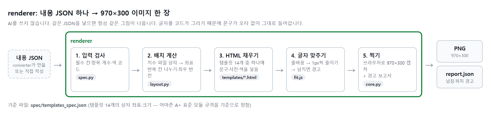
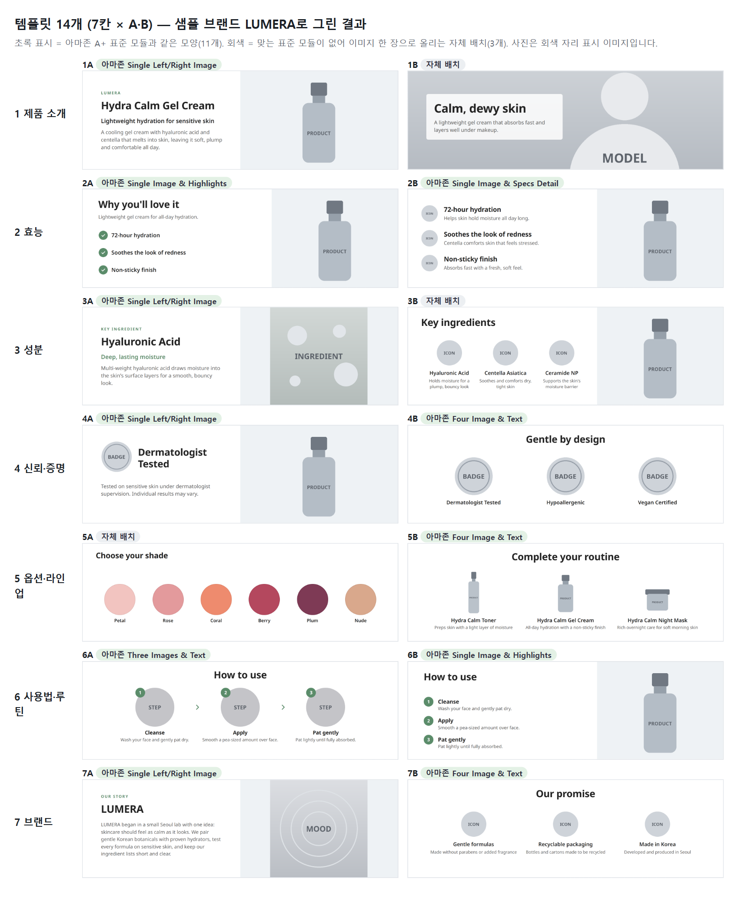
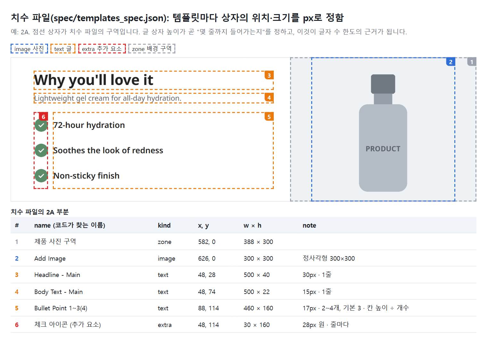
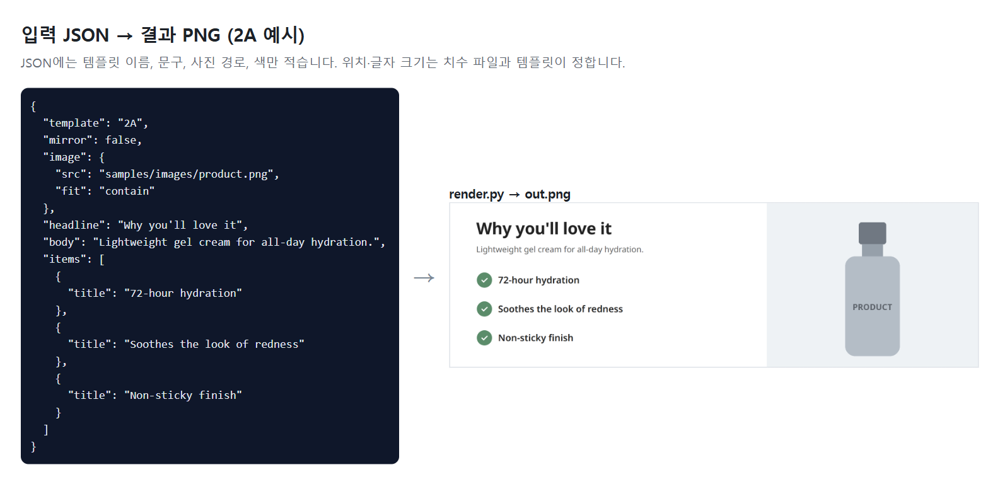
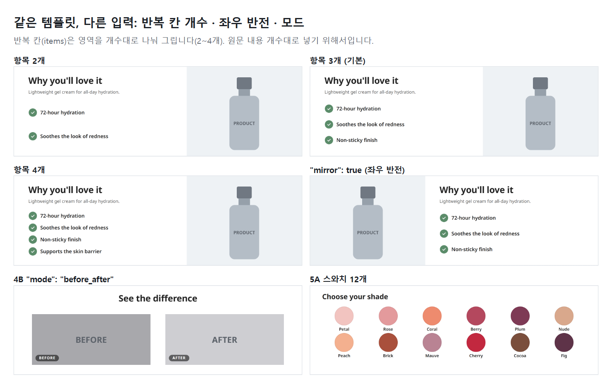
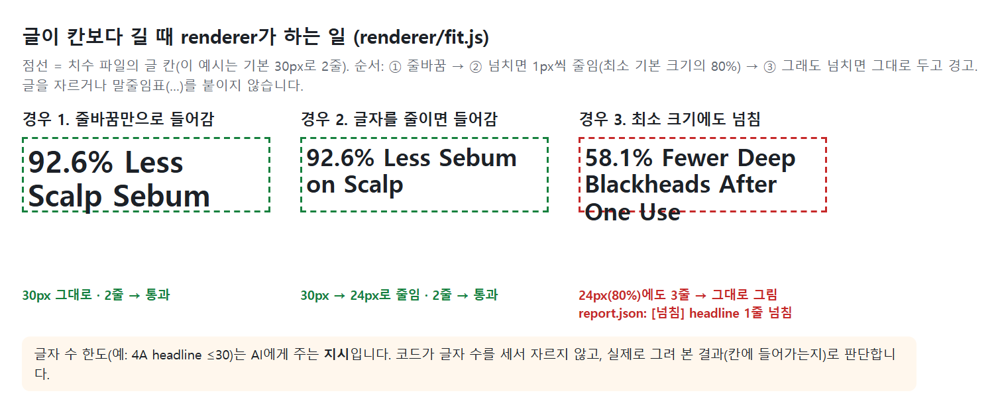
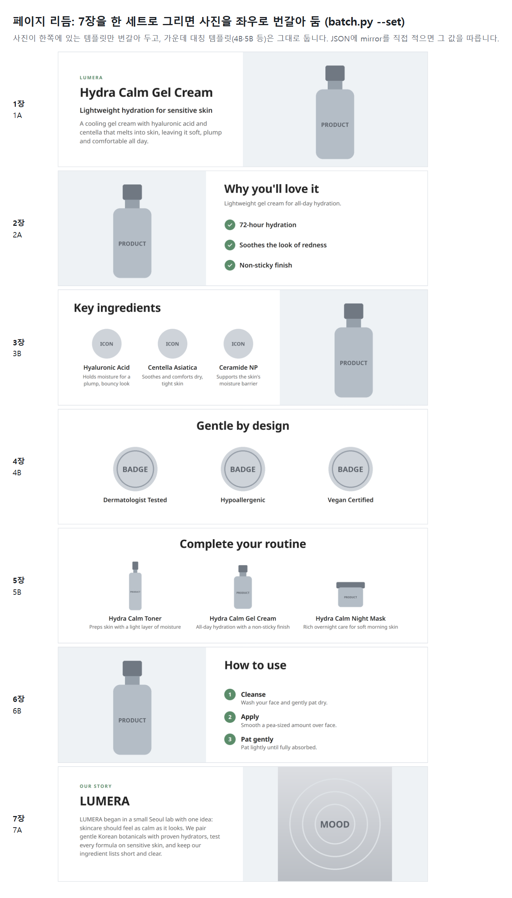
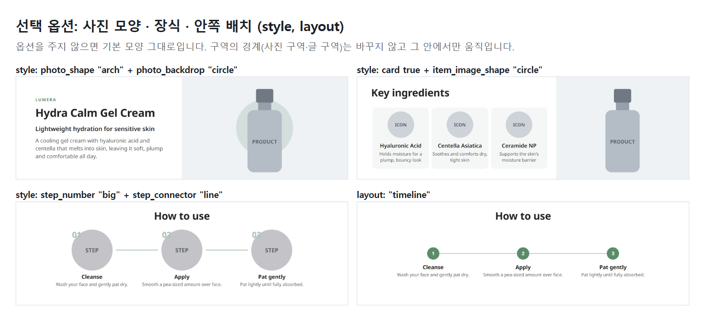

# A+ 템플릿 렌더러 (renderer)

**내용 JSON 하나**를 넣으면 **아마존 A+ 모듈 이미지 970×300 PNG 한 장**을 그리는 코드입니다.

> **이 코드를 어떻게 쓰면 되나요**
> - 서비스에 그대로 넣는 코드가 아닙니다. **참고용 시제품**입니다. 모델 담당자가 읽고 서비스 구조에 맞게 옮겨 구현하는 것을 전제로 썼습니다.
> - 한국 상세페이지를 읽고 JSON을 만드는 쪽은 같은 저장소의 **`aplus-converter` 브랜치**(`aplus_auto/` 폴더)입니다. **전체 흐름(한국 상세페이지 → 7장)은 converter README에 있습니다.** 먼저 그쪽 1장을 읽으시길 권합니다.
> - renderer는 **AI를 쓰지 않습니다.** 같은 JSON을 넣으면 항상 같은 그림이 나옵니다.

> ### ✅ 아마존 A+ 가이드를 먼저 기준으로 삼았습니다
> 템플릿 14개의 모양과 치수는 **아마존 A+ 표준 모듈 규격을 먼저 기준으로** 정했습니다.
> - 14개 중 **11개가 아마존 표준 모듈과 같은 모양**입니다(Single Left/Right Image, Single Image & Highlights, Single Image & Specs Detail, Four Image & Text, Three Images & Text).
> - 맞는 표준 모듈이 없는 **3개(1B·3B·5A)는 자체 배치**입니다. 이미지 한 장으로 만들어 Image 모듈로 올립니다.
> - 칸별 글자 수 한도도 **아마존 가이드 상한을 넘지 않게** 정했습니다. 한도 표와 가이드 비교는 converter README 4장에 있습니다.
> - 반복 칸의 사진 개수만 의도적으로 다르게 두었습니다. 가이드처럼 3개·4개로 고정하지 않고, 원문 개수대로 2~4개를 받습니다.

---

## 목차
0. [3분 요약](#0-3분-요약)
1. [renderer 안에서 일어나는 일](#1-renderer-안에서-일어나는-일)
2. [템플릿 14개와 아마존 표준 모듈](#2-템플릿-14개와-아마존-표준-모듈)
3. [치수 파일](#3-치수-파일)
4. [입력 JSON 형식](#4-입력-json-형식)
5. [글이 넘칠 때](#5-글이-넘칠-때)
6. [세트로 그리기: 좌우 번갈아](#6-세트로-그리기-좌우-번갈아)
7. [선택 옵션: 사진 처리 · 장식 · 안쪽 배치 · 아이콘](#7-선택-옵션)
8. [보고서와 경고](#8-보고서와-경고)
9. [서비스로 옮길 때 알아둘 것](#9-서비스로-옮길-때-알아둘-것)
10. [파일 목록](#10-파일-목록)
11. [설치와 실행](#11-설치와-실행)

---

## 0. 3분 요약

| 질문 | 답 |
|---|---|
| 무엇을 넣나 | 내용 JSON (템플릿 이름, 영어 문구, 사진 경로, 색) |
| 무엇이 나오나 | 970×300 PNG + 경고 보고서(`*_report.json`) |
| 템플릿 | 14개 = 7칸 × A·B. **11개가 아마존 표준 모듈 모양** |
| 위치·크기는 누가 정하나 | 치수 파일 `spec/templates_spec.json` (px 단위) |
| 글자는 누가 그리나 | **코드가 그립니다** (HTML + 브라우저 캡처). AI가 그리지 않으므로 오타가 없습니다 |
| 글이 길면 | 줄바꿈 → 글자 1px씩 줄이기(최소 80%) → 그래도 넘치면 **자르지 않고 경고** |
| 가장 먼저 읽을 파일 | `spec/templates_spec.json`(치수), `renderer/layout.py`(배치), `renderer/fit.js`(글 맞추기) |

---

## 1. renderer 안에서 일어나는 일



| 순서 | 하는 일 | 파일 |
|---|---|---|
| 1 | **입력 검사:** 템플릿마다 필수 칸이 있는지, 항목 개수가 맞는지, 색 코드가 맞는지 확인합니다. 틀리면 오류를 냅니다 | `renderer/spec.py` |
| 2 | **배치 계산:** 치수 파일의 상자를 그대로 씁니다. 반복 칸은 영역을 개수대로 나누고, 좌우 반전이면 x를 `970 − x − 너비`로 바꿉니다 | `renderer/layout.py` |
| 3 | **HTML 채우기:** 템플릿 HTML에 문구·사진·색을 넣습니다 | `templates/*.html`, `base.css` |
| 4 | **글자 맞추기:** 브라우저 안에서 줄을 바꾸고, 넘치면 글자를 줄이고, 그래도 넘치면 기록합니다 | `renderer/fit.js` |
| 5 | **찍기:** Playwright(Chromium)로 970×300을 캡처하고 보고서를 만듭니다 | `renderer/core.py` |

**왜 HTML로 그리나요?** 줄바꿈, 글꼴, 글자 크기 조절을 브라우저가 정확하게 해 주기 때문입니다. 디자이너가 템플릿을 CSS로 바로 고칠 수도 있습니다.

---

## 2. 템플릿 14개와 아마존 표준 모듈



| 칸 | A | B |
|---|---|---|
| 1 제품 소개 | 1A — **Single Left/Right Image** | 1B — 자체 배치 (사진이 칸 전체, 글 상자를 위에 얹음) |
| 2 효능 | 2A — **Single Image & Highlights** | 2B — **Single Image & Specs Detail** |
| 3 성분 | 3A — **Single Left/Right Image** | 3B — 자체 배치 (성분 나열 + 제품 사진) |
| 4 신뢰·증명 | 4A — **Single Left/Right Image** | 4B — **Four Image & Text** (전후 모드 있음) |
| 5 옵션·라인업 | 5A — 자체 배치 (색상 스와치 최대 12개) | 5B — **Four Image & Text** |
| 6 사용법·루틴 | 6A — **Three Images & Text** | 6B — **Single Image & Highlights** |
| 7 브랜드 | 7A — **Single Left/Right Image** | 7B — **Four Image & Text** |

- **굵은 글씨 = 아마존 표준 모듈과 같은 모양(11개).** 아마존 가이드의 배치(사진 위치, 제목·항목·본문 구성)를 그대로 따랐습니다.
- 결과는 칸마다 970×300 **이미지 한 장**입니다. 셀러는 Image 모듈에 이 이미지를 올리면 되고, 표준 모듈의 칸을 다시 채울 필요가 없습니다.
- 칸마다 A·B 중 무엇을 쓸지는 converter가 원문 내용을 보고 고릅니다(converter README 5장).

---

## 3. 치수 파일

`spec/templates_spec.json`에 템플릿마다 상자(구역)의 위치와 크기가 px로 적혀 있습니다. **템플릿의 실제 모양은 이 파일이 정합니다.**



| 구역 종류(kind) | 뜻 | 그림 색 |
|---|---|---|
| `image` | 사진이 들어가는 자리 | 파랑 |
| `text` | 글 칸. 높이가 곧 "몇 줄까지 들어가는지"를 정함 | 주황 |
| `extra` | 체크 원, 번호 원 같은 추가 요소 | 빨강 |
| `zone` | 배경 구역 (사진 구역 바탕색 등) | 회색 |
| `ref` | 참고용 구역 | 보라 |

- 이 치수는 아마존 A+ 이미지 2,054장을 분석하고 아마존 표준 모듈 규격에 맞춰 정했습니다(분석 코드는 올리지 않음).
- **글 칸 크기 → 들어가는 글자 수 → converter의 글자 수 한도**로 이어집니다. 칸을 바꾸면 converter의 한도(`step4_fill.py`의 `SPECS`)도 함께 봐야 합니다.
- **좌표를 고치려면** 숫자를 바꾸고 `make_gallery.py`를 다시 실행해 확인합니다. **`name`은 코드가 찾는 열쇠라서 바꾸면 안 됩니다.**
- 치수 파일과 다르게 처리한 점이 있으면 보고서의 `notes`에 남습니다.

---

## 4. 입력 JSON 형식



```json
{
  "template": "2A",
  "mirror": false,
  "theme": { "bg": "#FFFFFF", "photo_bg": "#EEF2F5", "text": "#222222", "accent": "#5B8C6A" },
  "image": { "src": "samples/images/product.png", "fit": "contain" },
  "headline": "Why you'll love it",
  "body": "Lightweight gel cream for all-day hydration.",
  "items": [
    { "title": "72-hour hydration" },
    { "title": "Soothes the look of redness" },
    { "title": "Non-sticky finish" }
  ]
}
```

| 칸 | 뜻 |
|---|---|
| `template` | 1A, 1B, 2A, 2B, 3A, 3B, 4A, 4B, 5A, 5B, 6A, 6B, 7A, 7B |
| `mirror` | `true`면 사진과 글의 좌우 위치를 바꿈. 글 묶음 안의 순서(체크 원 → 글)는 그대로 |
| `theme` | 색 4가지(+ 선택 `accent_text`). 빼면 기본색. `#RRGGBB` 형식 |
| `image` | 큰 사진. `"경로"` 또는 `{"src": "경로", "fit": "contain/cover"}`. 제품 누끼는 `contain`, 모델·무드 사진은 `cover` |
| `headline` | 제목 (4B·5B·6A·7B에서는 가운데 모듈 제목) |
| `subheadline` | 1A·3A의 한 줄 설명 |
| `body` | 본문 |
| `label` | 1A 브랜드명 라벨. 3A 기본값 "KEY INGREDIENT", 7A 기본값 "OUR STORY" |
| `items` | 반복 칸. 칸마다 `title`, `body`, `image`, `color`(5A 스와치 색), `icon` 중 필요한 것 |
| `mark` | 4A 인증 마크 이미지(선택). 없으면 테두리 원과 체크로 그림 |
| `mode` | 4B 전용. `"before_after"`면 전후 이미지 2칸 |
| `layout` | 안쪽 배치 변형 (7장). 2A `"single"`(대표 하나형), 6B `"prose"`(줄글형) 등 |
| `style` | 사진 처리·장식 옵션 (7장) |
| `overlay` | 1B 글 뒤 반투명 상자 (기본 `true`) |
| `round_images` | 6A 단계 이미지를 원형으로 (기본 `false`) |

**이미지 경로**는 JSON 파일 위치 → 이 폴더 순서로 찾습니다. 절대 경로도 됩니다.

### 템플릿별 필수 칸 (없으면 오류)

| ID | 표준 모듈 | 필수 | items 개수 · 칸마다 필수 |
|---|---|---|---|
| 1A | Single Left/Right Image | headline, image | – |
| 1B | 자체 배치 | headline, image | – |
| 2A | Single Image & Highlights | headline, image, items | 2~4 · title |
| 2B | Single Image & Specs Detail | image, items | 2~4 · title |
| 3A | Single Left/Right Image | headline, image | – |
| 3B | 자체 배치 | headline, image, items | 2~4 · title |
| 4A | Single Left/Right Image | headline, image | – |
| 4B | Four Image & Text | headline, items | 2~4 · title, image (전후 모드는 정확히 2) |
| 5A | 자체 배치 | items | 2~12 · color 또는 image |
| 5B | Four Image & Text | headline, items | 2~4 · title, image |
| 6A | Three Images & Text | headline, items | 2~4 · title |
| 6B | Single Image & Highlights | headline, image, items | 2~4 · title |
| 7A | Single Left/Right Image | headline, image | – |
| 7B | Four Image & Text | headline, items | 2~4 · title |

- 2B·3B·6A·7B에서 항목에 `image`가 없으면 번호 원을 그립니다(`icon`을 주면 아이콘).
- **반복 칸이 2~4개인 이유:** 아마존 가이드는 Three Images는 3개, Four Image는 4개로 정해 두었습니다. 하지만 원문에 단계가 2개뿐인데 칸을 억지로 채우면 없는 내용을 만들게 됩니다. 그래서 원문 개수대로 받습니다(의도한 차이).



샘플은 `samples/content/`(기본 14개)와 `samples/content/variants/`(변형)에 있습니다. 새 JSON을 만들 때 복사해서 쓰면 됩니다. 샘플은 가상 브랜드 LUMERA와 회색 자리 표시 사진을 씁니다.

---

## 5. 글이 넘칠 때



1. 칸 안에서 줄을 바꿉니다.
2. 그래도 넘치면 글자를 1px씩 줄입니다. **최소는 기본 크기의 80%**입니다(예: 16px → 13px).
3. 그래도 넘치면 **자르지 않고 그대로 그립니다.** 보고서 `warnings`와 갤러리에 빨간 경고를 띄웁니다.
4. 말줄임표(…)로 자르는 기능은 없습니다.

**자르지 않는 이유:** 기계적으로 자르면 뜻이 깨지고, "Results may vary." 같은 꼭 필요한 문장이 빠질 수 있습니다. 넘쳤을 때 문장을 다시 짧게 쓰는 일은 converter(AI)나 사람이 해야 합니다.

1A·3A는 글 칸을 위에서부터 쌓습니다. 제목이 두 줄이면 한 줄 설명과 본문이 아래로 내려가고, 글 전체가 y 248 안에 들어가는지 검사합니다. 넘치면 본문 → 제목 → 한 줄 설명 순서로 글자를 줄입니다.

---

## 6. 세트로 그리기: 좌우 번갈아



```
py -3.12 batch.py samples/sets/lumera_auto -o out --set            (첫 장 사진 오른쪽)
py -3.12 batch.py samples/sets/lumera_auto -o out --set --start left
```

- 폴더의 JSON을 **파일 이름 순서**로 한 세트로 봅니다.
- 사진이 한쪽에 있는 템플릿(1A 2A 2B 3A 3B 4A 6B 7A)만 오른쪽 → 왼쪽 → … 번갈아 둡니다.
- 통짜·대칭 템플릿(1B 4B 5A 5B 6A 7B)은 반전하지 않고, 세는 순서에서도 건너뜁니다.
- JSON에 `"mirror": true/false`를 **직접 적은 장은 그 값**을 따르고, 다음 장은 그 장의 반대로 이어 갑니다.
- 참고: converter는 자체 규칙(`zigzag.py`, 1B 글 상자 방향까지 셈)으로 `mirror`를 정해서 넘깁니다.

---

## 7. 선택 옵션

**옵션을 하나도 주지 않으면 기본 모양 그대로**입니다(샘플 42장을 픽셀 단위로 비교해 확인했습니다).



### 7-1. 사진 처리 · 장식 — `"style": { ... }`

| 이름 | 값 (첫 번째가 기본) | 적용 |
|---|---|---|
| `photo_shape` | square · rounded · circle · arch | 큰 사진. circle·arch는 꽉 채워 자름 (1B 제외) |
| `photo_backdrop` | none · circle · blob · arch · gradient | 큰 사진 뒤 도형 (강조색을 사진 배경색에 옅게) |
| `photo_border` | none · thin | 큰 사진 얇은 테두리 |
| `item_image_shape` | square · rounded · circle | 반복 칸 안 작은 이미지 |
| `headline_underline` | none · bar · line | 제목 밑줄 |
| `label` | text · pill | 1A·3A·7A 라벨 |
| `step_number` | filled · outline · square · big | 6A·6B 번호 |
| `step_connector` | arrow · line · dotted · none | 6A 단계 사이 |
| `margin_deco` | none · dots · corner · circle | 글·이미지를 가리지 않는 빈 모서리에만, 최대 2개 |
| `card` | false · true | 3B·4B·5B·7B 반복 칸을 연한 카드로 |
| `icon_style` | fill · line | 아이콘 모양 |

- 장식에는 글자를 넣지 않습니다. **인증 마크·배지·별점·"No.1" 같은 그래픽은 만들지 않습니다**(4A 마크, 4B 배지는 입력 이미지만 씀). 근거 없는 인증 표시가 생기지 않게 하기 위해서입니다.
- 다른 템플릿에 쓰면 무시하고 보고서 메모에 적습니다. 없는 이름·값은 오류입니다.

### 7-2. 안쪽 배치 변형 — `"layout": "..."`

| 템플릿 | 쓸 수 있는 값 |
|---|---|
| 1A · 3A · 4A · 7A | vcenter (글 덩어리 세로 가운데) · center (글 가운데 정렬) |
| 2A | single (대표 하나형: 제목 + 짧은 문단, 항목 없음) |
| 2B | zigzag (2·4번째 줄 들여쓰기) |
| 4B · 5B · 7B | cards (카드형 가로) |
| 5A | chips (둥근 사각 스와치) |
| 6A | zigzag · timeline |
| 6B | timeline · prose (줄글형: 단계 번호 없이 제목 + 문단, 최대 7줄) |

- 경계(사진 구역·글 구역)는 바꾸지 않고 그 안에서만 움직입니다. 칸 크기가 바뀌면 글 넘침 검사를 그 크기로 다시 합니다.

### 7-3. 아이콘 · 글자용 강조색

- **`items[i].icon`**: 아이콘 이름(2B·3B·7B만). 항목에 `image`가 없을 때 번호 원 대신 뜻 아이콘을 그립니다. 사진이 있으면 사진이 먼저입니다.
  - 아이콘 32개는 `renderer/icons.py`에 있습니다. **직접 그린 24×24 그림이라 외부 라이선스 문제가 없습니다.** 아이콘마다 한국어 뜻이 붙어 있습니다.
- **`theme.accent_text`**: 강조색을 글자로 쓸 때의 색입니다. 밝은 강조색(예: 노랑)이 바탕에서 안 읽힐 때 같은 계열의 진한 색을 줍니다.
- **어떤 아이콘을 쓸지, 장마다 배경색을 어떻게 번갈아 둘지는 renderer가 아니라 converter가 정해서** JSON으로 넘깁니다(`icon_pick.py`, `bg_rules.py`).

---

## 8. 보고서와 경고

`render.py`는 `out_report.json`을, `batch.py`는 폴더의 `report.json`을 만듭니다.

| 항목 | 뜻 |
|---|---|
| `size_ok` | 970×300(또는 배율)으로 정확히 찍혔는지 |
| `overflow` | 넘친 글이 있는지 |
| `texts` | 글 칸마다 `base`(기본 크기), `final`(실제 크기), `lines`(줄 수), `overflow` |
| `warnings` | 사람이 읽는 경고: `[넘침]`, `[위치]`(치수 구역 밖으로 나감), `[장식]`(장식이 글을 가림), `[이미지]`(불러오지 못함), `[크기]` |
| `info` | 참고: `[밀림]`(1A·3A에서 제목 2줄 때문에 아래 글이 내려감) |
| `notes` | 치수 파일과 다르게 처리한 점 |

화면 출력 예:
```
완료: out.png  (970×300)  템플릿 2A
  경고 [넘침] headline: 1줄 넘침 (칸에 들어가는 줄 1줄, 30→24px까지 줄여도 2줄)
```

---

## 9. 서비스로 옮길 때 알아둘 것

| # | 내용 | 지금 상태 | 정해야 할 것 |
|---|---|---|---|
| 1 | 그리는 방식 | HTML + Playwright(Chromium) 캡처 | 서버에서 브라우저를 돌릴지, 다른 그리기 방식으로 바꿀지. 바꾸면 줄바꿈·글자 줄이기(`fit.js`)를 같은 규칙으로 옮겨야 함 |
| 2 | 넘침 처리 | 자르지 않고 경고만 | 경고가 나면 converter에 다시 짧게 쓰게 할지, 사람이 고칠지 |
| 3 | 치수 파일 | 템플릿 모양의 기준 | 칸 크기를 바꾸면 converter 글자 수 한도도 함께 바꾸기 |
| 4 | 글꼴 | Noto Sans (SIL Open Font License, 상업 사용 무료) | 브랜드 글꼴을 쓸지 |
| 5 | 아마존 기준 | 대행사 가이드와 표준 모듈 안내로 확인 | 셀러센트럴 실제 화면으로 최종 확인 |
| 6 | 출력 크기 | 970×300 (검토용 `--scale 2` = 1940×600) | 업로드용은 기본값(1)을 씀 |

---

## 10. 파일 목록

```
aplus_renderer/
├─ README.md                    ← 이 문서
├─ images/                      ← 이 문서의 그림
├─ render.py                    JSON 하나 → PNG 한 장
├─ batch.py                     폴더의 JSON 여러 개 → PNG (--set: 세트로 좌우 번갈아)
├─ make_samples.py              자리 표시 이미지·샘플 JSON 만들기
├─ make_gallery.py              샘플 전체를 그려 미리보기 갤러리 만들기
├─ renderer/
│   ├─ spec.py                  치수 파일 읽기, 입력 검사
│   ├─ layout.py                템플릿별 배치 계산 (반복 칸 나누기, 좌우 반전)
│   ├─ core.py                  HTML 채우기 → 브라우저 캡처 → 보고서
│   ├─ fit.js                   글 맞추기·넘침 검사 (페이지 안에서 실행)
│   ├─ rhythm.py                세트로 그릴 때 좌우 번갈아
│   └─ icons.py                 뜻 아이콘 32개 (직접 그림)
├─ templates/                   base.css, _base.html, _macros.html, _s1.html, 1A.html … 7B.html
├─ spec/templates_spec.json     치수 파일 (템플릿 모양의 기준)
├─ fonts/                       NotoSans-VF.ttf, OFL.txt (글꼴 라이선스)
└─ samples/                     images/ (회색 자리 표시), content/ (샘플 JSON), sets/ (세트 예시)
```

---

## 11. 설치와 실행

> Windows와 Python 3.12에서 만들었습니다. 명령은 모두 이 폴더에서 실행합니다.

```bash
py -3.12 -m pip install playwright jinja2 pillow
```

Chromium(화면을 찍는 브라우저)을 설치합니다. 사용자 폴더 이름에 한글이 있으면 문제가 생길 수 있어서 `C:\ms-playwright`에 설치합니다. 렌더러는 이 폴더가 있으면 자동으로 그곳의 브라우저를 씁니다.

```powershell
$env:PLAYWRIGHT_BROWSERS_PATH="C:\ms-playwright"; py -3.12 -m playwright install chromium
```

**한 장 그리기**
```bash
py -3.12 render.py samples/content/2A.json -o out.png
```
- `--scale 2`: 1940×600으로 선명하게 (검토용)
- `--html out.html`: 채워진 HTML도 저장

**여러 장 한 번에**
```bash
py -3.12 batch.py 내JSON폴더 -o 결과폴더
```
- `--recursive`: 하위 폴더까지
- 입력 오류가 있는 파일은 건너뛰고 `report.json`에 이유를 적습니다.

**미리보기 갤러리**
```bash
py -3.12 make_gallery.py
```
- `preview/gallery.html`을 브라우저로 엽니다. 위쪽 **구역 선 보기** 버튼을 누르면 치수 파일의 구역이 점선으로 겹쳐 보입니다.
